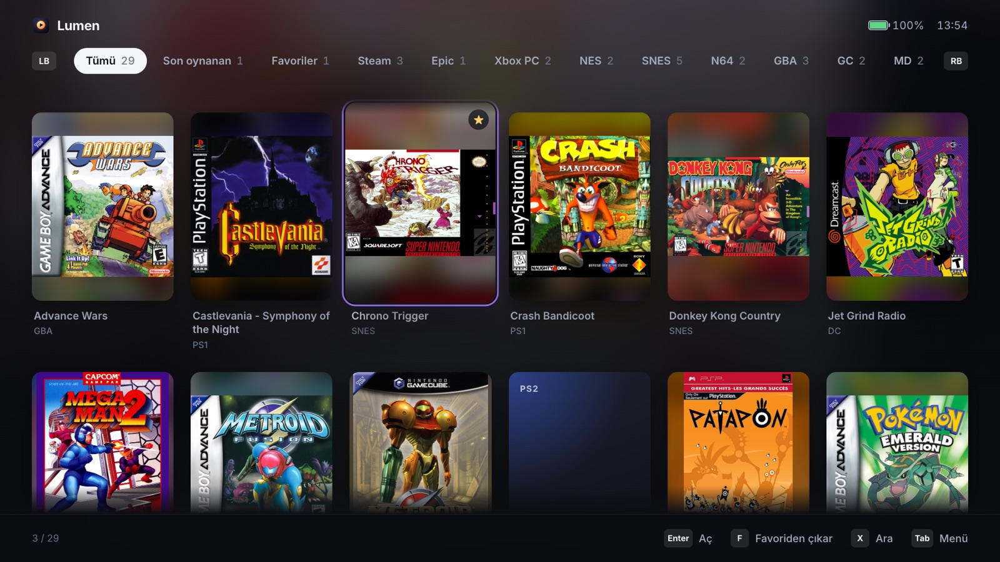
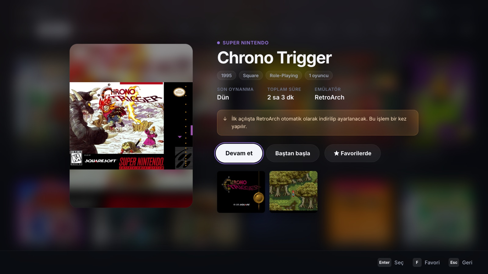
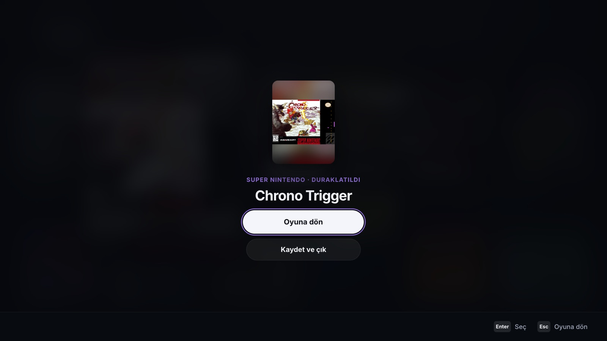
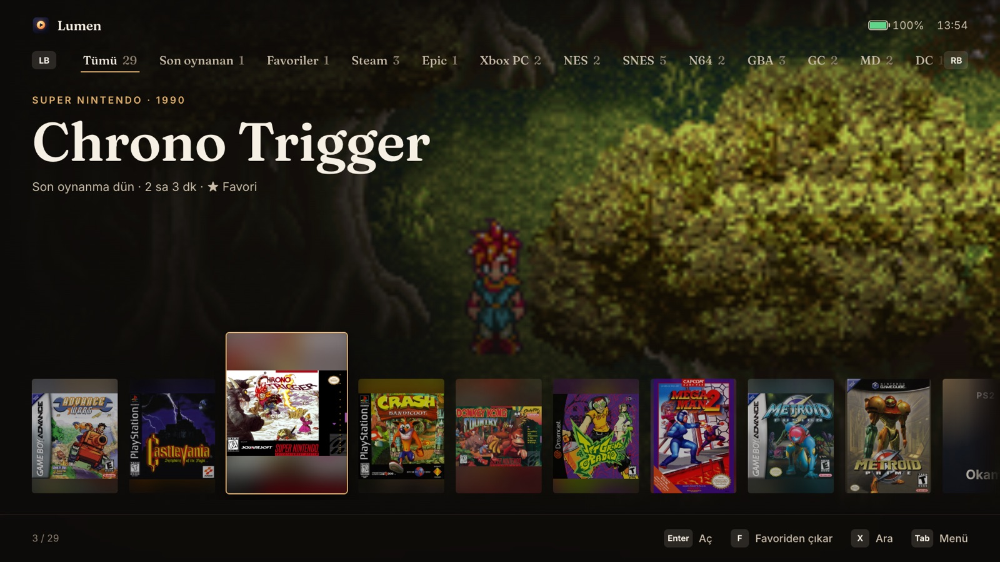
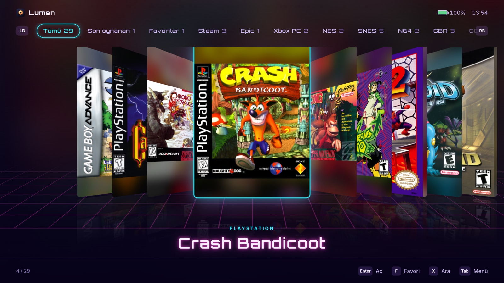
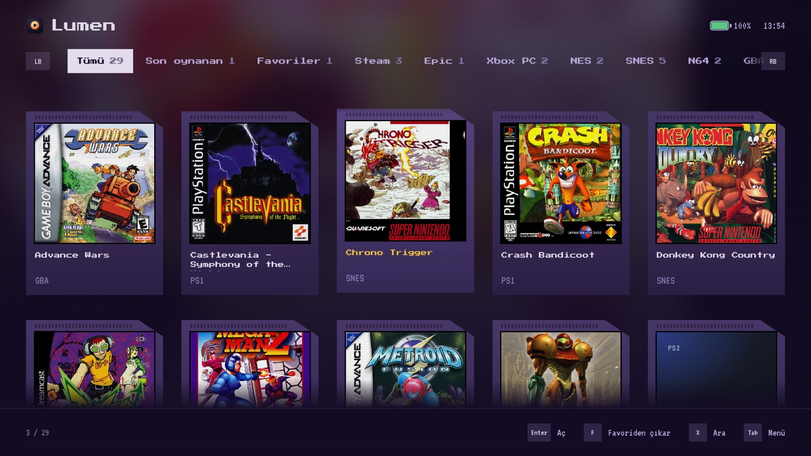
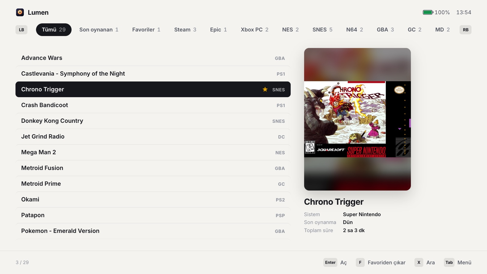

<div align="center">


# Lumen

**Every game on your handheld, in one console-like screen.**

A gamepad-first, fullscreen emulation frontend for Windows handhelds like the ASUS ROG Ally.
Lumen installs and tunes the emulators itself, finds your games and starts them fullscreen,
so you never open an emulator window.

[](https://github.com/akkanferhan/lumen/actions/workflows/ci.yml)
[](LICENSE)


[Product page](https://www.ferhanakkan.dev/lumen) · [Download a test build](#install) · [Features](#features) · [Themes](#themes)



</div>

> **Status:** early development. Builds run on Windows 11; the ROG Ally family is the target device.

## Features

| | |
|---|---|
| **One setup, every system** | Pick a game folder; Lumen creates the system folders, downloads emulators from their official releases and writes their configs. |
| **Tuned for the Ally** | Detects Z1 / Z1 Extreme / Z2 A / Z2 Extreme and applies per-emulator presets: Vulkan, internal resolution per GPU tier, async shaders, borderless fullscreen, controller mapping, no first-run wizards. |
| **Quick menu** | Tap **Select + Start** in any game: the game pauses and Lumen comes up. Hold it to save and quit. Sleep also pauses the game. Emulators that can't pause on their own are frozen while the menu is open. |
| **Continue where you left off** | Resume states for RetroArch, DuckStation and PCSX2, with a *Start over* option. |
| **PC games too** | Installed Steam, Epic Games and Xbox app (Game Pass) titles sit in the same library. |
| **RetroAchievements** | Sign in once; achievements work in RetroArch, DuckStation, PCSX2, PPSSPP and Dolphin. |
| **Save backups** | Saves and save states are mirrored after every session, to OneDrive by default. |
| **Free games** | 130+ homebrew games for NES, SNES, N64, Game Boy, GBA, DS, Master System, Mega Drive and Dreamcast whose licenses allow it, plus arcade classics their rights holders made free (non-commercial, via mamedev.org). One press to install. |
| **Import your dumps** | Pick a folder (USB stick, Downloads): each game's system is detected from its file header and it is copied or moved into the right folder, cue tracks and multi-disc sets included. A built-in guide shows how to dump your own cartridges and discs. |
| **Power modes** | Switches the ASUS Silent / Performance / Turbo mode per system, restored afterwards. |
| **Console mode** | Starts with Windows, fullscreen, controller only. |
| **Uninstall from the couch** | Remove any game from its details screen: emulated games go to the Recycle Bin (saves stay), Steam opens its uninstall dialog, Xbox app games are removed by Windows. |

<table>
  <tr>
    <td></td>
    <td></td>
  </tr>
  <tr>
    <td align="center">Game details: facts, screenshots, continue or start over</td>
    <td align="center">Quick menu while a game is paused</td>
  </tr>
</table>

## Themes

Seven themes, each with its own layout, type and navigation, not just colors (Menu → Theme):

<table>
  <tr>
    <td></td>
    <td></td>
  </tr>
  <tr>
    <td align="center"><b>Galeri</b>: full-screen game art, serif headlines, a cover rail</td>
    <td align="center"><b>Neon</b>: 3D cover flow over a synthwave grid</td>
  </tr>
  <tr>
    <td></td>
    <td></td>
  </tr>
  <tr>
    <td align="center"><b>Kartuş</b>: cartridge cards, pixel type, CRT scanlines</td>
    <td align="center"><b>Sade</b>: light, a fast list with a large preview</td>
  </tr>
</table>

Also **Işık** (the default cover grid), **Raf** (a shelf per system) and **Kâğıt** (a monochrome zine).

## Supported systems

| Maker | Systems | Emulator |
|---|---|---|
| Nintendo | NES, SNES, N64, Game Boy / Color / Advance | RetroArch |
| | DS · 3DS | melonDS · Azahar |
| | GameCube, Wii · Wii U | Dolphin · Cemu |
| Sega | Master System, Mega Drive, Saturn, Dreamcast | RetroArch |
| Sony | PlayStation · PS2 · PSP | DuckStation · PCSX2 · PPSSPP |
| | PS3 · PS4 (experimental) · PS Vita | RPCS3 · shadPS4 · Vita3K |
| | PS5 (experimental) | SharpEmu |
| Microsoft | Xbox · Xbox 360 | xemu · Xenia Canary |
| Arcade | FinalBurn Neo | RetroArch |
| PC | Steam, Epic Games, Xbox app | their own launchers |

PS5 runs on SharpEmu, which is in early development: expect most games not to boot yet.
PS4 and PS5 games are installed folders (the one that holds `sce_sys/` and `eboot.bin`).

## Games and BIOS files

Lumen never downloads commercial games or copyrighted BIOS files; use dumps of games and hardware you own.
The only games it fetches are the free ones above, straight from their authors or rights holders.
What it provides on its own:

| System | Without your BIOS |
|---|---|
| PS1, Saturn | Run on open-source HLE BIOS (PCSX ReARMed, Yabause); adding a BIOS switches to DuckStation / Beetle Saturn |
| PS3, PS Vita | System software (and the Vita font package) is fetched from Sony's official update servers |
| Xbox | xemu's blank HDD image is fetched; the MCPX and flash BIOS are still required |
| GBA, DS, Dreamcast, 3DS | Built-in BIOS replacements |
| PS2 | A BIOS dump is required |

```
<game folder>/
├─ snes/  ps2/  ps5/ ...  ← games, one folder per system
└─ bios/
   └─ ps1/  ps2/  ps3/  ps4/  xbox/  dc/
```

## Install

Every push to `develop` builds Windows installers. Open the latest
[Windows build](https://github.com/akkanferhan/lumen/actions/workflows/release.yml) run, download the
`lumen-windows-…` artifact and run the `.exe` installer. Builds aren't code-signed yet, so Windows
SmartScreen asks for confirmation (*More info* → *Run anyway*).

## How it works

- **[Tauri 2](https://tauri.app)**: a Rust core (downloads, emulator configs, process control, XInput,
  ASUS ACPI) under a React + TypeScript interface.
- **Emulator presets** are re-applied before every launch. Emulators keep their own state in their
  config files, so Lumen only sets the keys it owns (read–merge–write for INI, TOML, YAML and JSON);
  Xenia and SharpEmu get their settings as command-line flags. Every key was checked against the emulator's source.
- **Downloads** come from official releases only; a weekly CI job checks every source still resolves.

## Development

Requirements: Node 20+ and [Rust](https://rustup.rs).

```sh
npm install
npm run dev          # UI in the browser with a simulated backend (?demo for sample games)
npm run tauri dev    # the real app (emulators install and launch on Windows only)
```

- `src/`: interface · `src-tauri/src/`: Rust core · `src-tauri/emulators.json`: systems and emulators
- `scripts/homebrew-catalog.mjs` regenerates the free games catalog (Homebrew Hub plus the
  hand-checked `scripts/homebrew-extra.json`, where every entry cites its permission)
- Branches: `main` for releases, `develop` for integration, `feature/*` for each piece of work

### Releasing

1. Bump `version` in `package.json`, `src-tauri/Cargo.toml` and `src-tauri/tauri.conf.json`.
2. Merge `develop` into `main` and push a tag `vX.Y.Z`.
3. The workflow drafts a release with the installers and the signed `latest.json`; publishing it rolls
   the update out to Lumen's built-in updater (needs the `TAURI_SIGNING_PRIVATE_KEY` secret).

## License

[GPL-3.0](LICENSE). Lumen is not affiliated with ASUS, Microsoft, Nintendo, Sega, Sony or any
emulator project; emulators are downloaded from their own releases under their own licenses.
